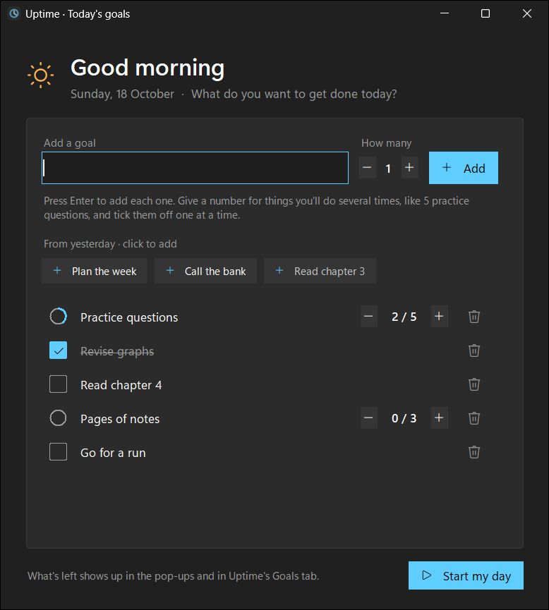

<p align="center"></p>

<h1 align="center">Uptime</h1>

<p align="center"><i>A simple, fun little project that helps me cut down on distractions… by making me feel guilty about them.</i></p>

---

I wanted an honest answer to *"where did my day actually go?"*. Uptime runs quietly in the background on my Windows laptop. It adds up every minute the laptop is **locked, asleep, shut down**, or sitting on a **shopping or social media site**. Then it shows me the total in a big, unforgiving number.

It turns out that seeing *"Wasted today: 6h 12m"*, *"You waste 33% of your time"* and *"Shopping · flipkart: 1h 40m this week"* is surprisingly good motivation to close the tab and get back to work. 😅 Each morning it also asks what I want to get done that day, and reminds me what's left whenever I drift off.


## What it does

- **Tracks wasted time automatically.** It counts time locked (Win+L), asleep or shut down, and time on distracting apps or websites.
- **Doesn't count your sleep.** Each morning, up to 8 hours of the night's laptop-off break counts as **Your sleep**, not wasted time (you can change the hours, or set 0 to turn it off). Stay up past that and the extra still counts.
- **Catches distractions.** Shopping (Amazon, Flipkart, Myntra, Meesho…), social media (Instagram, Reddit…), streaming (Netflix, Hotstar…) and games count as **Distracted** time.
- **Shows your history.** You get a 14-day chart, daily and weekly history, and a log of every break. Each day shows how much of it you wasted, e.g. *"58% of 16h 00m tracked"*.
- **Puts it in perspective.** The cards at the top turn hours into something that stings: *"You've wasted 26% of your time today"*, *"You waste 33% of your time"* on an average day, and *"That's 1.3 whole days a week"*.
- **Asks about anything new.** The first time you use a new app or website, a small prompt asks *"Is this for work?"*. Answer **Not work** and time there counts as distracted from then on. Answer **Work** and you're never asked again. Websites are recognised by their real address (e.g. `leetcode.com`), not just the tab title. You can review and change your answers in the dashboard.
- **Asks for today's goals.** The first time you're back each morning, a small window asks what you want to get done today. Add plain to-dos, or counters like *"5 practice questions"* that you tick off one at a time (2 / 5). Yesterday's unfinished goals are one click away. Tick things off in that window or any time in the dashboard's **Goals** tab, which also shows how earlier days went.
- **Nudges you with a pop-up.** A small Windows-style pop-up in the top-left corner shows *"5h 12m wasted today"* when you come back to the laptop, when you open a distraction, and every 10 minutes while you stay on one. If you've set goals, it also lists everything that's left, over as many lines as it needs: *"Still to do: 3 practice questions, Read chapter 4"*. It never takes focus, clicks pass straight through it, and it doesn't appear in screen shares or recordings.
- **Pauses on demand.** Pause for 3, 4 or 5 hours and Uptime switches off completely, with no tracking, no pop-ups and nothing running. It starts again by itself, and paused time doesn't count as wasted.
- **Lets you set your own rules.** Turn categories on or off, or add your own sites and apps. YouTube, messaging and music start off, because they aren't always distractions.
- **Looks like Windows 11.** It has a dark Windows 11-style dashboard, with smooth 144 Hz scrolling that works with precision touchpads too.

| Distractions | Breaks |
|---|---|
|  |  |

<p align="center"></p>

## Install

You need **Windows 10/11**. There are two ways to install it:

**As a single .exe** (no Python needed to run it)

1. Get `Uptime.exe`: build it by double-clicking **`Build Uptime.exe.cmd`** (this needs Python 3 once, just for building), which puts it in `dist\`.
2. Double-click **`Uptime.exe`**. It installs itself to `%USERPROFILE%\Uptime\app`, adds the shortcuts and starts tracking.
3. Open **Uptime** from your Desktop or the Start menu. To update later, run a newer `Uptime.exe` the same way.

Windows SmartScreen may warn about an unsigned app the first time. Click **More info → Run anyway**.

**From source** (needs **Python 3** from [python.org](https://www.python.org/), with "Add to PATH" ticked)

1. Download or clone this repo.
2. Double-click **`Install Uptime.cmd`**.
3. Open **Uptime** from your Desktop or the Start menu.

Either way, tracking starts right away and runs at every login. Uptime uses only Python's built-in libraries, and your data stays on your laptop, in `%USERPROFILE%\Uptime`. Switching between the two keeps all your history and settings.

## How it works

- **Background tracker.** `src/tracker.pyw` runs with no window. Every 10 seconds it records:
  - whether the session is locked, using the Windows session lock state
  - which window is in front, and whether it matches a distraction rule (websites by browser tab title, apps by program name)
- **Laptop asleep and shutdown.** Gaps with no recordings mean the laptop was asleep or off. If Windows restarted during the gap, it counts as **Shut down**; otherwise it counts as **Laptop asleep**.
- **Your sleep.** Each night's longest off/locked break (at least 3 hours, overlapping 12 am–9 am) is treated as sleep. The last 8 hours before you came back count as **Your sleep** and aren't wasted. This applies to past days too.
- **Pop-ups.** `src/toast.pyw` is the pop-up and `src/ask.pyw` is the "Is this for work?" prompt. Both share `src/osd.py`, which builds them directly on the Windows API rather than Tkinter: they never take focus (the prompt's buttons can be clicked without stealing focus), and they're excluded from screen capture. You can switch each one on or off in **Distractions → Pop-ups**.
- **Goals.** They're saved per day in `%USERPROFILE%\Uptime\goals.json`, and a day runs from 4 am to 4 am, so working past midnight still counts toward that day. When the tracker sees you come back after a break of at least 3 hours between 4 am and 2 pm, it opens the goals window (`dashboard.pyw --morning`) once a day, unless you've already set goals. Unlike the pop-ups, this window takes focus, because you type into it. You can turn it off in **Distractions → Pop-ups**.
- **Websites.** `src/siteinfo.py` reads the browser's address bar through Windows UI Automation, using only `ctypes`, to find the site you're on. It only reads when you switch windows or the page changes. Your answers live in `%USERPROFILE%\Uptime\labels.json` and take priority over the keyword rules.
- **Pause.** The dashboard's **Pause** button writes the pause end time and registers a one-time Windows Task Scheduler entry to restart the tracker. The tracker notices the pause and exits. When it restarts, it records the gap as **Paused** and removes the scheduled task. Click **Resume now** in the dashboard to end a pause early.
- **Dashboard.** `src/dashboard.pyw` is the dashboard, built with Tkinter and drawn to match Windows 11's dark theme.
- **The .exe.** `src/build.ps1` bundles everything into one file with [PyInstaller](https://pyinstaller.org/), which is installed into a private build folder (`%USERPROFILE%\.uptime-build`), not into your Python. `src/uptime.py` is its entry point: `Uptime.exe` opens the dashboard, and `--tracker`, `--toast`, `--ask` and `--morning` run the other parts, so the parts start each other the same way they do from source. On first run, `src/installer.py` copies the exe into place and points the shortcuts at it.
- **Averages and percentages.** Averages only use full days, meaning days that were at least 90% tracked, so a half-tracked first day doesn't skew them. Percentages are out of your waking, tracked time: **Your sleep** and **Paused** time are left out, because neither can be wasted. The weekly card divides the average week by 24 hours to show how many whole days that is.

## Uninstall

```powershell
powershell -ExecutionPolicy Bypass -File src\uninstall.ps1              # keeps your history
powershell -ExecutionPolicy Bypass -File src\uninstall.ps1 -DeleteData  # removes everything
```

---

<p align="center"><i>Built for fun. Use responsibly. Guilt is a feature, not a bug.</i></p>
